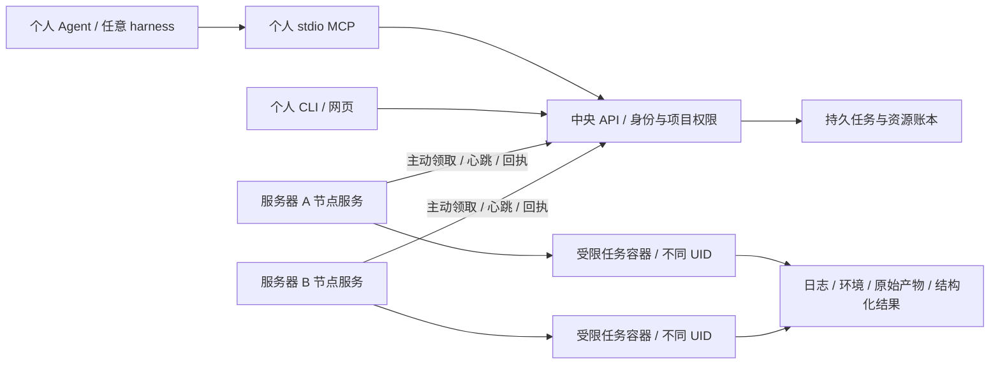

# 多用户/多服务器扩展边界与交付顺序

## 当前资源下的完善方向（2026-10-31）

本轮已补一次StartUnit意图、nonce消费及就绪/心跳前的准入暂停：567项回归和同机隔离Root协议演练通过，实际中央/Node各只启动一次并沿原计划恢复。真实PID1仍待，完整一键开户尚未接通。该进展不替代下面各层管理员验收，具体命令与限制见SERVER.md。

继续使用“个人 Agent → 稳定 API/MCP → 程序化中央调度 → 每台服务器的受信任 Node → 隔离任务”的结构。个人 harness 可以放在本人的宿主机账号或已有容器中；中央不保存个人模型密钥、聊天记录、私有 skill/MCP 配置。不同 Linux 用户的私有 HOME/权限提供隔离；仅在同一账号的不同目录运行 opencode 不能提供用户之间的安全隔离。

推广时优先保持 owner/project、任务/attempt、环境锁、输入/产物 ID 和提交接口稳定；新增服务器只登记节点身份、物理资源域、环境能力和本地 UID/存储映射。物理设备访问、文件系统配额和服务启动由管理员部署阶段提供，个人客户端沿用原协议。目标是保持接口兼容；仍需真实两机验收，不能提前承诺无需迁移处理。

| 优先项 | 现在继续完善 | 获得管理员服务器后验收 |
|---|---|---|
| 服务交付 | 版本化包、只读 doctor、排空、持久计划/回执、配置加载读回、升级/备份恢复 | 真实 systemd 启动和心跳、重启/断电恢复；新机安装后沿用个人客户端 |
| 多用户接入 | staged 身份→中央存储组→Node 工作/缓存槽→持久 ACK→最后交付凭据；中断后恢复或显式中止 | 两名真实 Linux 用户、私有 HOME 与凭据、现有用户扩新 Node、组织身份 |
| 可执行资源合同 | 单物理域唯一分配权威，CPU/RAM/SHM/PID、工作/缓存/暂存/归档的字节与 inode；未知执行仍保留租约 | NPU 设备白名单及非 root 运行、收敛绕过入口、异构两机与约20人混合负载 |
| 可复现实验 | 五类版本化任务、源码/补丁和工具链指纹、不可变产物、失败日志与个人下载；构建和上板分阶段排队 | 精度/性能/仿真真机验收、NPU故障/卡死及多机网络断连 |
| 可替换 Agent | 统一工具接口；能力包声明版本、输入、执行权限、结果和实验预算 | 对 msagent 等领域能力逐项接入，所有复现/编译/上板仍经过中央队列 |

msagent 项目公开提供性能、精度分析方向及 skills 目录，但“接入调度 MCP”不能自动继承另一个 harness 的执行器、记忆和工具依赖。后续分两类适配：可独立调用的分析工具以 MCP/CLI 暴露；依赖其完整运行时的能力作为受限领域服务，经统一任务协议申请实验。当前尚未验收该领域集成。[项目来源](https://gitcode.com/Ascend/msagent)

第一台管理员测试机先用独立资源池和少量用户；通过后再加入第二台服务器。暂不引入多活中央；节点离线、控制器重启、超时响应都先核对原 attempt，不能仅凭租约过期重跑或释放设备。断连期间的强制接管必须补 fencing，之后再评估数据库/HA。每日 PR 回归归因保留为 PUBLIC-001 后续公共任务，不在当前主机启用夜间编译或自动 revert。

当前个人 Main 仍是兼容试用入口：能观察既有容器，不会拦截其手动命令。管理员强制模式还须收敛 NPU、Docker socket 和既有特权容器权限；只修改可见设备环境变量不能实现强制管理。[Docker 权限边界](https://docs.docker.com/engine/security/)

## 当前推广计划（2026-10-30，优先于下方历史进度）

继续采用“个人 harness / CLI / 网页 → 统一 API → 程序化调度与资源账本 → 各服务器 Node → 任务容器”。新增服务器通过登记节点和管理员策略接入；不要求每个用户更换 harness、复制中央私有目录或共享模型密钥。这里的“平滑扩展”指保留客户端任务接口及证据格式，不表示新机器免配置、免权限迁移或免验收。

历史 v0.36 的公开范围见 [reports/v036-public.json](reports/v036-public.json)：432 项单元检查及 54 项自有 Root 容器安装检查通过，`production_ready=false`。已有身份/项目授权、物理域账本、环境锁、受限工作区、中央载荷配额、Node 暂存、私有缓存、阶段依赖及备份恢复实现。个人 Main 保留原兼容配置，**并未自动启用新安装的全部硬限制**。过去完整 Triton wheel 构建使用旧 tmpfs 提供器；当前 UID quota 下的完整 Triton 冷暖构建、20 个逻辑用户混合负载和独立原盘核验已通过；最新全量回归为 478 项，证据见 reports/mixed-compiler-stage.json 和 reports/public-source-check.json。历史 Root54 不自动覆盖后续修复；混合案例绑定其冻结发布包，不等于重新执行全部安装检查。随后旧命令产物合同修复另有450项回归和独立CLI升级验收。随后原生UID槽追加有独立的安装CLI、7个SIGKILL及相邻旧包兼容验收；它尚未接通完整开户，见OWNER_PROVISION.md。Root 容器中的不同 UID 不代表真实宿主账号或两台物理机。

| 优先级 | 继续开发或冻结的约定 | 推广前必须取得的证据 |
|---|---|---|
| P0 接口与身份 | job/attempt、所有者、项目 ACL、幂等键及产物摘要保持稳定；中央用户 ID 与各节点 UID 映射分离 | 个人客户端安装后独立运行；两名真实 Linux 用户互不可读会话、token、Skill/MCP 私有配置；共享仅按项目授权 |
| P0 调度权威 | 每个物理域只有一个资源分配权威；外部进程列为未托管占用，不能因瞬时空闲便保证设备独占 | 管理员试点先划出专用受控卡；迁移已有全设备/privileged 容器和 Docker 权限后，验证用户及 Agent 无法绕过获批设备集合 |
| P0 混合负载 | CPU 构建、NPU 精度、性能及仿真分阶段排队；预算覆盖 CPU/RAM/SHM/PID、工作盘/暂存/缓存/归档字节和 inode | 当前提供器上的冷暖构建与 19 个其他逻辑用户的 57 项小任务已通过，两槽运行、35 项实际重叠。推广后还须加入真实 NPU 精度/性能/仿真混合；不把 20 个提交者称为 20 个同时运行者 |
| P0 节点资格 | 资格按芯片、驱动、运行时、镜像、工具链及任务身份绑定；未通过的能力保持关闭 | 非 root 设备访问、ACL 初始化、物理/容器编号、未授权卡拒绝、真实精度/性能/仿真、取消后清退分别通过；环境变化后重验 |
| P1 一键交付 | 分发固定发布包；配置区分 controller、node 和个人 client；预检、安装、登记、验收、升级/回滚分别可观察 | 空白管理员试点机安装、重复安装无副作用、真实 systemd PID1 重启、专用数据盘和证书配置、停机备份到新目录恢复；不把配置文件示例当实测 |
| P1 运维与用户生命周期 | 新 owner 的 UID/GID/目录/硬配额统一预配；明确禁用账号时排队任务、在途任务、token 和数据保留策略 | 批量开户、撤权、配额变更、磁盘/inode 满、缓存回收及控制数据库/审计增长边界；已有中央 owner 的离线扩缩容不等于全部配额管理已完成 |
| P1 跨机故障 | Node 主动领取并持久化执行身份；未知任务保留资源，恢复先对账；单活中央先于高可用 | 第二台真实主机、断网/Node 重启/中央恢复、撤销节点凭据、旧中央隔离；未确认旧执行停止前不重复启动设备任务 |
| P2 领域能力 | Skills、分析工具与 harness 适配分别版本化；分析只读本人/授权项目证据，追加实验重新提交任务 | 已知精度错误、编译错误、卡死及流水案例逐项验收，报告区分事实/假设/实验；更换 harness 后验证工具权限和输出一致性 |

推荐推广顺序：当前账号内的 CPU 混合负载已通过，继续补齐用户生命周期与可迁移发布包；再在首台管理员服务器开两名真实用户和少量专用卡；接入第二台物理服务器验证跨机故障；最后扩大到约 20 人峰值并验收混合负载。首个节点可只开放通过验收的 CPU/IR 模板，不等待所有 NPU 能力一起开放。中央初期继续单活，不因增加计算节点同时引入第二个独立调度账本。

用户生命周期的身份阶段增加了中央待预配身份：禁用且不生成凭据，Node管理侧可提前登记，资源各层尚未确认前不能通过普通启用或续发令牌绕过。469项完整回归包含真实HTTP/SQLite/安装包CLI和恢复/降级检查；尚未把中央GID、Node工作区及缓存绑定与最后激活连成完整开户。该阶段没有重跑Root54或在真实宿主创建账号，操作及交付条件见 [OWNER_PROVISION.md](OWNER_PROVISION.md)。

随后中央owner存储组追加已接通独立安装CLI、7个SIGKILL恢复、原生EDQUOT和其他组继续写入、进程重启补充组及相邻旧代码回滚。最新478项回归通过，60个生产源码摘要与该Root案例一致。账号仍待预配，Node工作/缓存绑定和最后激活未接通；已有systemd unit补充组更新仍须补齐，不能由进程模式结果推导真实systemd验收通过。

Node本地用户/工作/缓存绑定随后已验证，当前486项回归通过。旧BishengIR缓存保留原key/inode/归属并暖命中，新UID使用独立缓存；同一计划10个连续SIGKILL边界可恢复。该Node使用fixture stage ID，完成后保留待中央确认标记并拒绝启动。正式推广仍需中央批准/ACK、登记同步、最后身份激活及systemd组更新，不能将本地绑定回执当作完整开户或两机验收。操作和阻断条件见OWNER_PROVISION.md。

中央批准/ACK阶段随后已连通，该阶段497项回归通过。实际安装的非Root中央与Root Node使用真实stage/GID和节点凭据，额外9个连续ACK中断点可恢复；本地/登记投影及回执一致，实际Worker健康心跳已观察。新身份仍禁用且无令牌，不能把交接成功当成凭据交付完成。最后激活、systemd组更新、两实际系统用户/两机和NPU资格仍需验证；本Demo当前已加载该能力，既有预算未改。

个人 Agent 可放在用户自己的主机账号或开发容器中；两种位置使用相同 API。公共 harness 二进制和公共能力包可只读分发，HOME/XDG、会话、模型凭据和个人配置按真实用户隔离。进入不同项目目录不构成权限隔离；OpenCode 还会合并全局与项目配置，接入器应检查最终生效配置。[OpenCode 配置规则](https://docs.opencode.ai/docs/config/)。普通用户和个人 Agent 不取得 Docker socket；Docker 管理权限属于主机信任边界。[Docker 官方权限说明](https://docs.docker.com/engine/install/linux-postinstall/)。

PUBLIC-001 夜间回归继续作为后续公共项目：专用机器人身份、低优先级资源预算、冻结基线/候选环境及结果归档。凌晨 02:00 是最早提交时间，不保证立即占卡；资源不足继续等待。PR 归因优先产出可复现实验和修改/revert 建议，公共分支变更另走明确授权与审查。

v0.34候选把真实Triton/CMake/ccache作为普通托管CPU构建工作流；版本锁覆盖实际后端/工具/兼容审计文件，产物进入归档与结果表。采用单独固定任务镜像，不需要改变中央或Node服务角色镜像。管理员扩容时应据实际inode消耗准备缓存配额。提供器证据不替代安装后HTTP/MCP/备份恢复的新验收，后者以evidence/validation-v034.json为准；NPU数值/性能/仿真仍需实机资格。

v0.33候选补文件及目录同步边界和输入重置的崩溃安全顺序。部署验收应区分进程强制终止恢复、文件系统同步语义和宿主掉电；当前不以SIGKILL测试推导真实掉电、磁盘控制器故障或跨机fencing已完成。权威范围见evidence/validation-v033.json。

v0.32候选增加CPU构建与设备阶段分离的依赖任务图、按摘要封存产物交接、无提前占卡、失败传播及交接恢复。原个人配置不自动增加NPU能力或修改现有Docker；完整验收以evidence/validation-v032.json为准，真实NPU/两物理机/systemd等门槛继续保留。

v0.31候选补私有持久缓存的任务请求、中央预留、Node挂载和租约/GC/同盘恢复；旧个人Main仍默认工作区缓存。完整验收以evidence/validation-v031.json为准，不能由旧provider证据推导当前集成已通过。后续继续阶段DAG、真实混合构建/NPU/systemd/两机等。

v0.30候选补齐有限Node暂存盘和可重入产物收集，控制/租约/回执另盘，元数据恢复只重绑同一空盘。新controller install默认require_finite_node_spool=true；原个人配置保留兼容默认false，不作为生产已启用证明。下一阶段仍需持久缓存、阶段DAG、GiB规模混合、实际systemd/两机及NPU资格。详见 [SPOOL.md](SPOOL.md)。

v0.29候选把中央owner输入、归档、回收站合并到内核组配额，固定任务UID与中央服务UID隔离，恢复按数据库owner重新绑定目标存储组。Root准备用于已启用组配额的专用空盘；Node暂存、持久缓存、真实systemd/两机和NPU各级资格仍需继续完成。存储说明见 [STORAGE.md](STORAGE.md)，实际验收以`evidence/validation-v029.json`为准。

v0.28候选补齐Node工作区的UID字节/inode硬配额、owner映射与共享盘额度合计，准备工具只接管理员已启用配额的专用空ext4。当前仍待新的完整Root安装验收；中央每用户载荷硬配额和持久缓存继续待做，不能把Node配额等同完整存储隔离。详见 [WORKSPACE.md](WORKSPACE.md)。

## 2026-10-30 当前接入方案与门槛

v0.27源码补齐**设备文件访问**这一级资格状态及调度门禁：固定探针提供受保护证据，失败阻断同条件设备工作流，身份/声明环境/主机与受保护代码变化或到期后需重验；备份恢复不沿用已通过资格。网页只显示汇总，操作见NPU.md，发布范围见validation-v027.json。ACL、编号/隔离、数值、性能、仿真等完整节点能力资格仍待实机验收，不能由这一级推导。

此前 **v0.25** 交付基线的 `evidence/validation-v025.json` 记录301项单元检查和31项自有Root安装/恢复检查。v0.26源码新增托管工作流的任务身份设备访问检查；新的服务发布及验证范围以 `evidence/validation-v026.json` 为准。独立 `npu-*-v026.json` 诊断文件本身不表示服务发布或NPU计算验收。这些演练都在同一物理服务器完成；当前并未验收多台真机或团队NPU生产运行。下文旧版本进度按历史证据阅读，不把其“尚未实现”覆盖已完成的新版本能力。

扩展时保持“个人harness → CLI/MCP → 中央API/队列 → 节点 → 受限任务容器”不变。新服务器增加节点与管理员策略，个人客户端继续使用相同身份和任务接口。单机当前可用的安装、CPU/离线IR及存储恢复证据不替代新机器的驱动、权限和故障演练。

| 顺序 | 现在继续补齐的内容 | 管理员服务器上的接入验收 |
|---|---|---|
| 1. 身份与入口 | 个人凭据/项目权限、独立HOME/XDG、任务可见性与私有产物；公共网页只展示授权摘要 | 两名真实Linux用户互不可读；普通用户无Docker socket；迁移已有privileged/全设备容器后验证不能绕过用卡 |
| 2. 节点资格 | 分别报告管理观测、非root设备访问、ACL初始化、数值、性能、仿真是否通过；按芯片/驱动/镜像/工具链指纹登记 | 一台干净试点节点完成单卡编号映射、未获批卡拒绝访问、真实精度、性能、仿真与取消清退；环境变化后重新验收 |
| 3. 工作与存储预算 | 已有专用有限工作区、中央载荷分盘、传输续接/摘要确认/保留及恢复；继续补每用户字节/inode硬配额和持久缓存 | 专用真实磁盘上做大编译、磁盘满/inode满、缓存回收、GiB备份及中断恢复；控制数据库和载荷盘分别留余量 |
| 4. 工作流分阶段 | 继续实现编译→精度→性能/仿真依赖；阶段间传封存产物，编译只申请CPU/内存/SHM/工作盘 | 固定基线/候选并保留原始样本、频率及外部占用；性能阶段按所需范围独占，不把整段长编译持续占卡 |
| 5. 多机恢复 | 保持节点主动领取、幂等提交、一次性启动许可、未知状态保留和对账；继续补完整旧中央fencing | 第二台真机、真实systemd PID1、断网/中央与节点重启、旧中央隔离、凭据撤销；同一attempt不重复启动 |
| 6. 领域能力 | 将日志/IR/profile分析能力声明为有版本的输入输出与工具权限；先只读，再做有预算的实验 | 相同已知故障经不同harness复现；追加编译/上板仍入队；分析结论与已验证修复分别记录 |

目前已有设备文件访问这一级状态机；完整节点资格仍需逐层形成可复核合同。静态doctor通过、设备管理查询成功、设备文件打开或任务退出0都不能单独授予完整NPU能力。

现有NPU排查强化了这个要求：五个新建受限容器身份对照都出现管理查询失败和设备open EBUSY，包括零capability的UID0；补充用户名/组名或先Root启动再降权没有使它恢复。只读驱动表已可聚合解析，但注册记录尚不能证明根因或设备独占。详细证据见 [NPU.md](NPU.md)。不通过扩大任务权限来替代验收。

建议按四步推广：当前账号内完善与冻结接口；首台管理员测试机加两名真实用户；第二台不同环境节点验证跨机恢复；最后用约20名并发用户的编译/精度/性能/仿真混合任务验收容量。每步只开放已通过的模板。早期保持单活中央，第二台计算服务器加入不要求同时增加第二个调度中央。

“一键安装”应是一条消费明确配置的幂等安装命令：先只读预检，再安装选定角色、校验登记并输出状态；驱动、存储和身份条件不满足时明确阻断对应能力。它不能承诺自动安全修复所有旧服务器。当前已有doctor/install及分角色安装器，真实systemd、多机/完整NPU验收和统一资格报告仍需补齐。

PUBLIC-001夜间回归继续延期。未来定时器只提交低优先级公共项目任务；工作区、模型身份、预算和报告权限独立，不读取个人对话或自动改公共分支。

## 历史实现与证据

2026-10-30 v0.23：新增文件后备 ext4 工作区的真实非root持久请求、字节/inode ENOSPC、清理及后续IR工作流验收，Root角色/HTTPS/恢复链路一起验证。自有loop关联在卷卸载后按backing身份确认释放，无宿主块设备格式化或全局挂载变更。它补齐小型磁盘文件系统证据，仍不等于中央输入/归档硬配额、物理分区/宿主重启、大构建盘/持久共享缓存或两台真机验收，详见 [WORKSPACE.md](WORKSPACE.md)。

2026-10-30 v0.22 实测补充：冻结的 Triton 源码任务 job-7504b588b164 已完成真实全量 Triton 编译、wheel 打包、私有安装、新原生扩展导入及离线 IR 变换。独立个人客户端下载 1,253,270,190 字节 wheel 并核对 5,416 项 RECORD；中央结果表、异用户隐藏、节点摘要回执和副本回收、空工作区均通过，证据 full-build-live-validation.json。外部 LLVM/BishengIR 只读复用，没有重新构建；任务无 NPU，工作区为独立 32GiB tmpfs，不能替代真实磁盘或 NPU 验收。

同一编译尝试运行期间，20 个不同逻辑账号并发读取本人身份/任务/结果共 60 次，另有 20 次跨用户读取均返回 404。项目 HTTP/TLS 监听 backlog 从 Python 默认 5 调整到 64；复测尾延迟下降、总体中位数上升，不能据此宣称一般性能提升。账号及令牌已停用/撤销。这是单机 HTTP 读请求演练，未覆盖真实 20 人混合任务、TLS 压力或大历史数据库。中央重载后同一原容器和尝试恢复，首次即时观察断言失败且未保存瞬时状态，不声称状态始终连续。详见 read-load-comparison-validation.json 和 listener-reload-live-validation.json。

v0.22：个人客户端的只读诊断 MCP/CLI 按任务 ID 收集有限日志和环境/结果证据，使用中央原有 ACL 与分块接口；不依赖共享 /home，也不让个人 harness 持有节点密钥。入口与真实验证范围见 CLIENT.md/HARNESS.md。固定 environment_probe 可显式申请有界内存，仍受普通用户/节点/物理域配额约束；旧节点缺少对应能力时等待升级。完整源码构建、独立 wheel 验收和管理员部署各有单独证据，不能用诊断摘要或预检替代。

v0.21：新节点具有按输入/产物申报额度与 inode 的暂存准入、中央摘要回执和已确认节点副本回收，原尝试重连/中断续接不重跑。新中央默认要求 node-spool-v1；旧部署先升级全部节点再启用 require_node_spool。实际磁盘硬配额、持久缓存和两机验收仍缺，见 STORAGE.md。

v0.20：中央输入/终态归档新增按本人所有权的显式隔离、恢复、延迟永久删除；删除确认后才退预留，结果/环境证据/审计保留，备份恢复重绑定文件身份。操作与默认 7 天保留期见 [STORAGE.md](STORAGE.md)。此能力不是磁盘硬配额或节点缓存 GC，没有自动回收计划。

v0.19：原生HTTPS、可迁移CA配置和同CA证书续期见 [HTTPS.md](HTTPS.md)。默认本机HTTP不变；管理员可显式配置对外TLS监听。

v0.18：节点执行清单、当前中央实例确认与物理域对账阻断见 [RECOVERY.md](RECOVERY.md)。新安装默认启用；旧配置需更新全部启用节点后显式切换。

v0.17：中央环境认证与资源预留前的版本匹配见 [ENVIRONMENTS.md](ENVIRONMENTS.md)。新安装默认启用；旧配置需在空闲节点认证并确认后显式启用。

2026-10-29。此文区分当前可复核能力与接下来必须补齐的内容，不是已完成生产部署的声明。当前安装与演练全部在本 Demo 目录和自己新建的容器内，没有修改宿主机账号、系统服务或其他项目。

2026-10-30 v0.16：已实现只读安装预检并接入install前置阻断；见SERVER.md。它使用同一包解析/静态校验，不创建安装目录/账号，不执行任务或NPU；缺Root权限、源包/路径/预算/镜像/能力等条件时明确阻断。节点绑定本地Unix socket与daemon ID，实际验证继承错误路由/个人Docker配置不改变执行位置，以及私有绑定故障后保留未知资源、恢复同容器/attempt。新中央默认要求pinned-docker-runtime-v1。上述是安装/执行位置保证，不能替代驱动/运行时、磁盘和两台真机验收；完整中央恢复fencing仍缺。

## v0.14 接入基线与下一步

现阶段保留确定性中央调度器、节点主动领取协议、版本化工作流和个人 MCP。新增服务器应增加节点及管理员策略，个人提交方式保持。这里承诺接口演进方向，不承诺未经验证的服务器可零配置运行；芯片、驱动、CANN、容器运行时和磁盘必须逐台验收。

| 优先级 | 当前资源下继续实现/验证 | 有管理员权限后的接入条件 | 可复核验收 |
|---|---|---|---|
| P0 身份与权限 | 本人 token、项目 ACL、撤销、多 UID 容器；个人 HOME/XDG/会话与模型密钥独立 | 两名真实 Linux 用户、HTTPS/组织身份；节点专用服务角色；旧特权/全设备容器安排迁移 | 对方私有日志/输入/会话不可读；普通任务无 socket、无节点凭据；错误 scope 被拒绝 |
| P0 NPU 能力 | 管理观测和任务执行分开；按固定镜像/工具链记录失败；繁忙时等待 | 目标服务器验证非 root 初始化、物理/可见 ID 映射和设备访问策略 | 一次精度→受控性能→仿真；未获批卡不可用；取消/卡死后确认清退 |
| P0 存储 | 封存输入、短路径、SHA、续传、个人归档、应用预算；已有 >1GiB wheel 与 tmpfs ENOSPC | 专用磁盘工作区、输入/归档硬配额、字节与 inode、独立缓存预算 | 实际磁盘 ENOSPC 不扩散；未知任务不释放槽；GC 不删活动输入/归档；全量备份恢复 |
| P1 调度策略 | 同物理域单一资源权威；配额/轮转、老化优先与CPU碎片保护已有；继续构建/交互/性能类别及 DAG | 每节点标签、芯片/镜像/工具链能力、性能测量独占策略 | 长任务无饥饿；编译阶段不占卡；仅兼容节点领取；20人混合负载而非仅CPU突发 |
| P1 恢复与交付 | 私有数据与只读代码分开；安装、排空、备份/新目录恢复、兼容升级回滚已有 | systemd PID1、第二台真机、证书/密钥轮换、恢复 fencing | 断网/节点退出/中央重启不重复启动；旧中央和旧许可不能继续产生新执行 |
| P2 领域 Agent | 保持自然语言→版本化请求→队列；分析已有日志/IR/profile，输出事实、假设、待验证实验 | 为能力包固定版本/许可、依赖、格式、工具权限、项目预算和输出 schema | 同一案例经不同 harness 得到可追溯结果；复现/编译/上板仍经调度，不由模型判定释放资源 |

当前小型原生工具链验收已经补齐：job-0c4ffef796be 实际编译 ELF，job-c4b22a0ae612 将该 ELF 作为封存的只读输入直接执行，UID23002、capability=0、文件0555/数据0444、写入被拒绝。证据为 readonly-input-live-validation.json；这是小工具输入权限验收，不是完整 Triton/NPU-IR 构建。158 项单元检查通过。大 wheel 传输证据来自 v0.13 的已验证发布包，不能用来声称本次重做了完整大构建。

新服务器的“一键”应拆成可预览的预检与幂等安装：报告现有 Docker/cgroup、CPU/RAM/SHM、NPU/驱动、文件系统、UID映射和端口；缺少条件时停止相应能力，CPU节点仍可独立接入。管理员准备设备/磁盘/证书后，用固定发布包分别安装 controller 或 node，再由独立个人安装器发布 CLI/MCP。现有安装器不自动重装驱动、收回他人权限、格式化磁盘或接管既有容器；后续预检报告的统一发布格式仍待实现。

推广初期保留单活中央及当前数据库，先测实际提交、日志与归档压力。后续若机构采用 Slurm 或 Kubernetes/Kueue，将底层调度封装为执行适配器，并明确每个资源域唯一分配权威；不允许自建账本与底层调度各自分配同一张卡。Slurm 支持显式通用资源，但 Ascend 设备发现/容器集成需另验；Kueue 是 Kubernetes 上的作业准入与配额方案，当前项目没有实现这些后端。[Slurm GRES](https://slurm.schedmd.com/gres.html)、[Kueue](https://kueue.sigs.k8s.io/docs/overview/)

领域能力优先按 Skills/工具接口复用；更换 harness 不等于自动迁移其内部编排、依赖与评测效果。msagent 已公布外部 Skills 接入方向，是否适配当前 Triton-Ascend/IR/仿真格式仍要逐项验证，公共服务不集中收集个人模型密钥。[msagent 官方说明](https://github.com/Ascend/msagent/blob/master/README.md)

## 稳定接口



中央调度由确定性程序负责准入、配额、状态机与资源释放。Agent 负责把意图转为合法请求、分析日志/IR、提出下一轮实验；追加实验仍需重新排队。模型中断不影响任务，模型声称“已完成”不能释放资源。无需让所有人使用同一种 harness，也无需让个人 Agent 取得 Docker socket。

节点主动连接中央，可避免中央直接 SSH 到每个用户账号或保存他们的 SSH/模型密钥。新增节点先登记物理标识、预算、允许模板、不可变镜像与用户映射，再交付专用节点凭据。任务、节点与执行尝试有独立 ID；一次性启动许可防止因本地状态丢失而重复执行。断线与未知状态保留资源，不能仅按心跳超时重新分配仍可能在执行的 NPU。

同一物理服务器可有多个执行入口，但它们必须共享资源域。当前两个 worker 和旧本地入口实际上只有一个物理资源域；不能将它们当作三台服务器。v0.9 已持久化整机CPU/内存/SHM/槽位预算、修订号、排空和变更审计，并验证多入口及并发执行。磁盘/缓存硬配额、受控NPU设备预算和实际多机仍待完成。

## 角色与信任

| 角色 | 持有的东西 | 权限边界 |
|---|---|---|
| 个人 CLI/MCP/harness | 本人 token、本人模型配置和会话 | 通过中央 API；不读取中央数据库或节点密钥 |
| 中央服务 | 身份、项目、队列、节点登记、归档 | 专用非 root 用户，无 Docker socket；对外用 HTTPS 或 SSH 隧道 |
| 节点服务 | 本节点密钥、管理员执行策略、私有控制状态 | 受信任的 Docker/设备管理角色；不能提供用户可任意指定的宿主挂载 |
| 任务容器 | 本次输入、只读环境、获批设备、单独输出 | 非 root UID，CPU/内存/SHM/PID 限制；无节点/模型密钥、无 socket |
| 管理员 | 安装、用户/节点授权、设备策略和恢复权限 | 管理员/root/Docker 管理员属于信任边界，不能靠个人目录抵御他们 |

个人工作目录本身不产生身份隔离。多个人共用同一 Linux UID 启动 opencode，即使目录不同，也不能保护彼此的会话、技能或密钥。不同 UID、700/600 权限、隔离的 HOME/XDG 是部署条件；项目共享必须显式授权。任务输出由中央 API 归档，不要求节点能读写每个人的宿主机主目录。

## 当前证据

| 已实现并实际演练 | 证据 | 实际限制 |
|---|---|---|
| 中央与节点独立状态，通过 HTTP 领取/回传 | worker-live-validation.json | 同一物理机演练，非两台真实服务器 |
| 中央 UID 24001 无 socket、节点 UID 0、任务 UID 23003 | root-roles-validation.json | 自己新建容器中的真实 UID，未创建宿主账号 |
| 不同任务 UID、cgroup、只读根、无网络、无凭据挂载 | managed-engine-validation.json | CPU 模板；未证明 NPU 设备隔离或任意恶意程序均安全 |
| 服务/节点重启同容器恢复、取消后确认退出与清理再释放 | worker-live-validation.json；test_nodes.py | 无灾难恢复 epoch、自动化安全人工处置工具尚待实现 |
| 独立安装个人 CLI/MCP、重连同一作业、实际产物下载 | client-live-validation.json；test_client.py | 单个受限 CPU 验收任务；个人 token 续发需管理员 |
| 真实 OpenCode/DeepSeek → MCP → 中央 → 节点 → 容器 | runtime/agents/runs 下相应 summary | 演示器按原授权读取 zdl 的一个模型配置；通用客户端不包含此逻辑 |

证据文件位于 evidence/。真实设备精度测试仍未完成：已有 NPU 进程的设备即使瞬时利用率为 0，也不会被当作空闲设备。一次空闲准入后发现旧 Docker exec 丢失设备访问组，已在 Demo 注册环境中修正；随后设备查询超时，重新申请在等待期结束后取消。分别留存 npu-device-permission-failure.json 与 npu-live-validation.json，不能记为精度通过。外部未托管任务不受当前协作式调度拦截。取得管理员权限后，要由设备权限/运行入口策略限制绕过，而不是让 Agent 监视并杀死他人进程。

v0.10补充：旧入口的管理查询已移到宿主可信执行器，经一次性、5秒有效、绑定任务UID的Unix通道复查；跨容器实测通过。受控节点已有可选NPU设备合同、白名单与驱动只读挂载、启动前/结束后观测协议，但实际probe遇到EBUSY，旧入口进一步在CANN9.1初始化时遇到507899。当前只在Demo登记已有CANN9.2环境，未完成该组合验证。管理员试点第一步必须校准驱动/运行时、物理与容器编号、非root设备初始化及清退；不能直接开启团队NPU生产调度。见[NPU.md](NPU.md)。

同轮已验证60MiB归档暂停35.8秒后恢复，尝试级回执避免误报失联；独立MCP重连原任务，不自动重复执行。安装后的公开代码可向个人发布CLI/MCP，Root角色交付现为9项检查通过。以上仍是同一物理机、自有容器的证据，真实多机与systemd PID1须在管理员试点补验。

## 后续实施优先级

1. **环境和实际工作流**：v0.7 已有五类版本化合同、API 输入封存、受保护环境锁与真实离线 IR/小编译验收，见 WORKFLOWS.md。继续验证实际精度/性能/仿真和 Triton/NPU-IR 包构建，补全目标芯片、源码 commit/脏补丁、构建选项与工具链兼容；固定镜像不替代实际工具指纹。设备环境不符应尽量在占卡前拒绝，不自动覆盖公共 wheel。
2. **设备与资源域**：节点上报设备健康与外部占用，按物理设备 ID 分配；实际验证设备白名单、非 root 访问、可见编号映射、取消/卡死/节点重启。编译不申请 NPU，只申请 CPU/内存/SHM/工作盘/缓存预算。v0.9 已验证多槽CPU、整机总预算和20逻辑用户突发提交；完整NPU/构建混合负载、公平老化和长任务饥饿尚待验收。
3. **结果与大产物**：v0.7 已实现五类 schema、按 ACL 分页的结果表/CSV、长 IR 路径映射与原始哈希。继续补实际数值参考/性能测量条件、客户端个人归档偏好与自动下载、wheel/完整 IR 的大规模传输恢复、磁盘硬配额/保留策略；当前 64 MiB/文件、128 MiB/任务仍不足以覆盖实际大构建。
4. **服务端交付**：v0.8 servicectl 已提供无凭据服务包、非root controller/root node安装、--start进程模式、代码完整性与Docker资源能力检查、私有配置、生成systemd文件和停机备份/新目录恢复/兼容切换回滚。自有Root容器中已创建专用账号并实际验收，见 SERVER.md。继续补systemd PID1实机、安装unit路径刷新、激活中断修复、设备/工作盘配额与真实多机交付；不能将CPU进程演练当作完整生产验收。
5. **恢复与团队接入**：一致备份任务库与身份/项目授权，恢复后暂停调度并核对实际执行对象；引入 epoch/fencing，防止旧节点回执或新旧中央并存。不要把独立 SQLite 文件的随意拷贝当作一致备份。再补 SSO、自助凭据续发、审计保留和真实两服务器验收。单活中央可作为初始部署，尚不具备自动高可用。
6. **诊断能力复用**：定义能力包输入/输出与权限，先封装只读分析，再开放受预算约束的复现/编译/性能实验。msagent 官方已有外部 Skills 与 msprof-mcp 接入路径；应复用这两个接口，再核验相应脚本对本地 Triton/IR/仿真格式的适配，而不是默认转移整个 harness。个人模型凭据留在个人 harness，公共诊断项目用单独项目身份。详见 [HARNESS.md](HARNESS.md)。

已有代码应保持接口和状态机，逐步替换执行与存储实现。当前无需为“多服务器”立即迁移 Kubernetes；将来若选择 Slurm/Kubernetes/Kueue 等作为底层资源调度，应让该资源域只有一个分配权威，由中央适配器提交和跟踪底层作业，不能让两套调度同时认为自己拥有同一张卡。

PUBLIC-001 的夜间回归/PR 归因继续按 BACKLOG.md 延期，不因有队列就自动启用定时构建、revert 或发布。

## 从当前试用迁移到管理员部署的具体合同

2026-10-29 补充。扩展时保持个人提交协议、任务 ID、环境 ID、产物 ID 和项目权限语义稳定，替换执行权限与存储后端。这里的目标是减少用户迁移成本；真实第二台服务器、驱动与设备隔离、系统服务尚未验收，不能承诺未经验证的无缝切换。

建议默认让个人 harness 运行在本人 Linux 账号的私有 HOME/XDG 中；已有个人容器中的 harness 也可通过相同 API/MCP 接入。任务容器由受信任节点按获批模板创建，个人 harness 不持有 Docker socket。用户在网页选择环境与任务即可，排障时再展示镜像、容器 ID 和执行命令。不让对话窗口的生命周期决定任务容器生命周期。

| 必须固定的合同 | 当前可做 | 管理员服务器必须补的保证 |
|---|---|---|
| 每个物理资源只有一个分配权威 | v0.9 独立物理域CPU/内存/SHM/槽位预算、事务预留、多槽恢复与20逻辑用户CPU突发验收 | 受控NPU/磁盘/缓存域预算及实际多服务器/混合负载 |
| 资源申报与实际约束对应 | 受控 CPU 任务已有 CPU/内存/SHM/PID 限制；旧 zdl 入口为协作式 | NPU 设备访问白名单、非 root 驱动访问、磁盘/缓存硬配额；实际检查限制生效 |
| 统一请求与版本协商 | API、五类版本化模板、节点 protocol/capabilities | 公布兼容窗口与升级顺序；节点不满足能力应明确等待或拒绝，不静默降级 |
| 不可变实验身份 | 输入内容清单、镜像和所声明工具指纹、结果原始证据 | 完整源码/dirty patch/LLVM/CANN/构建选项与 wheel 哈希；大产物与缓存完整性 |
| 身份与物理账号分离 | 服务端 owner/project、个人 token、节点到任务 UID 的映射 | 对接组织身份；每台机器本地 UID 映射可不同，不能用用户名字符串推断文件所有权 |
| 维护与恢复不重复执行 | 幂等提交、一次性启动许可、排空备份与兼容切换 | drain 模式、实际 systemd、迁移演练；在途恢复需 fencing 与真实执行对象核对 |

管理员若要强制所有 NPU 使用都经过调度，必须同时收敛普通用户对设备、rootful Docker socket 和既有特权/全设备容器的访问。只给新任务设置 ASCEND_RT_VISIBLE_DEVICES 或安装 MCP，无法限制仍有其他高权限入口的用户。迁移旧容器应安排维护窗口，不在当前共享主机直接收回权限或停止他人容器。[Docker 权限说明](https://docs.docker.com/engine/install/linux-postinstall/)

资源模型应至少包含：物理 NPU/设备内存、CPU 核、RAM、SHM 上限、工作盘字节和 inode、缓存额度、构建槽位、采集工具的互斥资源，以及管理员为系统和其他服务预留的余量。SHM 按具体 IPC/挂载命名空间计量，内存预算计入共享内存实际消耗，不能把容器 SHM 标称上限相加当成主机独立可用内存。Docker 参数还必须通过节点能力检查与实际压力场景确认有效。[Docker 资源限制](https://docs.docker.com/engine/containers/resource_constraints/)

调度策略建议先使用每用户/项目配额、公平轮转与等待老化，区分交互调试、构建、独占性能测量和低优先级公共任务。编译只申请 CPU/内存/磁盘，编译完成再申请 NPU 做精度，精度通过再申请性能/仿真；各阶段使用固定产物串联，避免整轮反复编译一直占卡。可回填短任务，但必须避免长任务持续饥饿。v0.9已有受预算约束的多槽和用户轮转，等待老化、任务类别/项目策略、DAG及长任务防饥饿尚未实现。

领域能力包应声明版本、支持的输入格式、所需工具、读写与执行权限、结构化输出以及最大实验轮数/预算。先复用 msagent 的只读分析能力；需要编译/复现/上板的步骤统一提交队列。配置了调度 MCP 不代表 harness 的内置 shell 或第三方脚本会自动受管，实际设备权限和运行适配必须同时约束。

## 推广验收顺序

1. 当前账号内先补实际五类工作流、完整构建与大产物；设备繁忙则保留等待/未运行结果，不放宽准入。
2. 首台管理员测试服务器：专用服务账号、HTTPS、节点资源与硬配额；两名真实 Linux 用户演练互不可读、设备越权拒绝、公平等待、取消/卡死、重启恢复和备份还原。
3. 第二台真实服务器加入同一中央：不同芯片/环境按能力匹配，断开任一节点不重复执行，撤销节点凭据不错误释放运行资源，验证归档无需共享 /home。
4. 用接近 20 人峰值的混合小任务检验队列、公平性、数据库/上传压力和预算；公布已验证的容量与不支持项，再逐步扩大到全体用户。公共夜间项目继续单列延期。

单活中央与当前数据库可以作为初期验证架构，不必因有 100 个可访问账号就立即增加高可用组件。应先压测任务与日志吞吐，并保留存储适配边界；跨主机/并发控制器需要数据库事务与调度领导权共同设计，不能仅把 SQLite 换成另一个数据库就宣称具备高可用。

v0.11个人归档已通过实际CLI/MCP的IR任务和60MiB断点续传验证：用户本地根目录偏好、来源映射、默认同级目录和完整性清单均由客户端管理，不发给中央。新增终态归档清单/分块接口沿用owner/project ACL；中央不需要挂载每个人的/home。个人客户端凭据轮换后仍按实际身份核对归档绑定，MCP的目录在会话创建时固定。详见CLIENT.md。大wheel/完整源码/缓存硬配额、保留策略、实际两机和设备验收继续待完成，不能将这一项通过替代管理员试点。

v0.12已补工作区硬边界接口与实际tmpfs验收，详见WORKSPACE.md：管理员预置独立有限文件系统槽位，中央按字节/inode/持久性独占分配，清理/回执前不释放；可信任务引导器再次验证实际挂载。新安装中央默认要求受限工作区，旧Demo保持兼容入口但显示未启用。实际32MiB/512 inode非root ENOSPC和后续IR通过；这不替代磁盘ext4、大编译、持久缓存与输入/归档存储配额的验收。XFS需独立项目配额提供器，不把statfs动态inode总量当固定硬限制。安装不自动分区/格式化宿主机。

## 当前增量：最后激活与个人UID

最后激活现有515项回归和同机安装演练：中央服务及管理CLI的实际补充组、每个明确指定Node的当前状态/回执/环境/工作缓存/暂存门槛通过后，私有凭据先落盘，再提交启用和token摘要。七个连续SIGKILL边界可恢复；可信管理员将凭据交给独立个人UID，实际API上传/幂等提交/单次BishengIR编译及归档清理通过，他人UID无法读取凭据。当前64个非文档生产源码与最终Root冻结包一致。个人目录交付仍由管理员执行，真实systemd组更新、未提交intent中止重规划、已激活用户扩到新Node、NPU预激活资格、组织身份和两物理机仍待。CPU数值UID演练不是完整生产验收，操作见OWNER_PROVISION.md。

## 既有 systemd unit 的离线更新

`unit-install` 仍拒绝覆盖已有文件。新增Root管理命令针对**已停止且静默的一个安装实例**，预览并更新由本项目生成的既有unit；不调用systemctl，不自动启用/重启服务，不操作其他unit。以下示例用于具有管理员权限的部署机，当前个人Demo没有修改宿主systemd。

先排空该中央/Node的作业、未知尝试、产物回执和缓存租约，再由实际服务管理器停止选定服务。中央追加存储组完成后，应在批准Node交接前完成unit文件更新和服务启动；已进入未完成交接或激活的操作仍需先按原流程恢复。

```bash
systemctl stop ascend-lab-controller.service
/opt/ascend-lab-controller/current/servicectl unit-refresh-plan \
  --prefix /opt/ascend-lab-controller --output /root/controller-unit-plan.json
/opt/ascend-lab-controller/current/servicectl unit-refresh-apply \
  --prefix /opt/ascend-lab-controller --plan /root/controller-unit-plan.json
systemctl daemon-reload
systemctl start ascend-lab-controller.service
```

Node同样支持，替换为其安装前缀及 `ascend-lab-node.service`。默认unit目录为 `/etc/systemd/system`，`--unit-dir` 可显式选择隔离安装目录。计划输出须是新的Root私有文件。程序核对当前安装/配置摘要、控制目录身份、目标目录、既有unit与模板的设备/inode/时间/内容/权限；只接受当前完整生成文本，或仅缺少新分配存储组的历史生成文本。自定义ExecStart、安全设置、未知组、链接、硬链接和常见unit/名称前缀/type-wide drop-in目录拒绝自动更新，不覆盖现有管理配置。附加配置的规则见 [systemd.unit官方说明](https://www.freedesktop.org/software/systemd/man/251/systemd.unit.html)。这些文件检查不代替实际manager的FragmentPath/DropInPaths/生效属性确认。

应用在独占状态锁下先写Root持久journal，再保存目标unit和安装模板的原始字节，随后原子替换目标文件和模板、发布回执并清journal。六个持久边界可沿同一计划恢复；中断后重复同一 `unit-refresh-apply`，不另建计划或删journal。未完成时正常验证/启动、备份、代码切换和其他配额维护均被阻断，配额恢复选项也不能绕过。已有内容无需变化时保留目标inode，仍保存审计回执；重复完成操作不再次替换。原始备份及回执在安装前缀的 `unit-refresh-history/<plan_id>/`，Root私有；应随安装管理资料保存，中央状态备份不代替该目录。

输出始终明确 `systemd_manager_contacted=false`，保留daemon-reload和服务启动的后续动作。最后开户检查还会读取真实中央进程的补充组，文件成功并不代表进程已加载。当前未提供自动回写旧unit的回滚命令；管理员需核对当前配置后决定恢复，不能把旧组列表直接覆盖回新存储合同。

已验收：真实安装Root CLI、中央存储GID追加、同计划六个连续SIGKILL及恢复、备份SHA一致、过期inode/手工内容/drop-in/活跃服务锁拒绝、未完成时备份/代码切换拒绝、无关unit保留，以及Node无需变化时的重放和inode保持。之后原中央/Node交接、个人UID激活、真实排队IR和归档清理继续通过；实际生成unit另经本机systemd-analyze校验。当前525项完整回归、65个非文档生产源码匹配最终Root包。Root演练只改隔离目录，中央实际以进程模式启动；**没有验收systemd PID1的加载/重启、别名或其他manager覆盖路径的生效配置、宿主账号或两机**。

## 未提交开户意图的恢复选择

除重复原激活操作继续完成外，当前提供本地管理CLI显式中止尚未提交的激活。状态命令返回ID而不暴露凭据，计划/应用绑定原文件和身份定义，只清理匹配私有文件，不回收资源或用户。中止journal和已中止ID账本阻断并发激活及不兼容降级，已提交账号不能走该路径。完成后可沿原就绪合同重新激活；旧中止计划保留新凭据，资源合同改变的重新授权协调仍待。当前完整541项与同机安装/八个连续SIGKILL恢复/新个人UID真实IR任务通过，66个非文档生产源码匹配最终Root包；不是实际systemd、两机或NPU验收。操作见OWNER_PROVISION.md。
