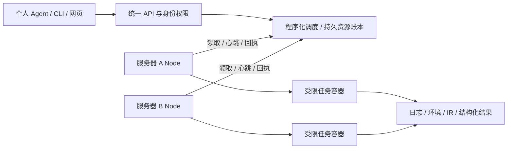

# AI-center-cann

新增精确Node/物理卡约束与固定NPU微自检入口：指定卡忙时等待，不改用另一张卡；个人客户端0.33可按UTC日期提交并复用原任务，归档中的2832个观察值可独立重算。最终1056项回归、隔离Root33与网页7通过；当前设备证据均为合成，没有新的真机自检、每日timer、性能基线或自动健康准入，见[NPU_SELFCHECK.md](NPU_SELFCHECK.md)。

新增任务设备条件证据：认证Node管理采样与启动/清退边界关联到原attempt，结果表、CSV和下载归档区分告警、缺项与采样未见告警；历史数据不补造验证，原精度/性能断言保留。1038项回归、同机隔离Root安装31项及8项浏览器检查通过，设备读数为合成协议证据。每日主动逐卡UT及实际频率适配仍待，见[NPU_CONDITIONS.md](NPU_CONDITIONS.md)。

已有用户的Node工作区与缓存可经停止态计划、中央批准、内核配额CAS和新鲜心跳调整，保留原缓存；旧快照不能丢失已保留的配额历史。最终1020项回归及同机Root安装32项通过，见[NODE_QUOTA.md](NODE_QUOTA.md)与[PROGRESS.md](PROGRESS.md)。每日逐卡UT新需求已登记[PUBLIC-002](BACKLOG.md)，尚未创建定时器或运行主动自检。

跨轮实验新增指定产物授权：本人明确批准旧任务的指定文件交给新预算，Agent仍不能读取旧任务/日志；支持撤销、传输中重启和恢复后重新审批。最终998项回归及同机隔离Root安装30项通过，历史精度11/5376差异保持原样。使用方法见[SOURCE_GRANTS.md](SOURCE_GRANTS.md)，证据范围见[PROGRESS.md](PROGRESS.md)。

任务详情新增精度、编译、仿真和历史性能报告摘要，仿真可按核切换查看管线记录区间。网页核对报告与确认归档的对应关系，并区分原任务状态、原采集异常和未重算的源文件；完整核验仍用个人CLI/MCP。接口及限制见[REPORT_VIEW.md](REPORT_VIEW.md)。

仿真流水新增CPU分析载荷及个人simulation-case CLI/只读MCP：按指令名和PC关联管线、统计区间并集并保留采集异常。962项回归及同机隔离Root安装30项通过；真实历史8核数据完成两用户离线分析及恢复，完整原件私有归档，模型接口只交付有限摘要。见[SIMULATION.md](SIMULATION.md)及[PROGRESS.md](PROGRESS.md)，不代表新的设备采集验收。

失败/超时产物可显式交给诊断任务，支持摘要封存、传输中重启续接及来源复核；默认成功依赖语义保持不变。请求格式见[DEPENDENCIES.md](DEPENDENCIES.md)，新服务器接入门槛见[DEPLOYMENT.md](DEPLOYMENT.md)。

面向 Triton-Ascend / AscendNPU-IR 开发服务器的 AI 任务调度与实验管理原型。程序化中央服务负责资源分配和可靠执行，个人 Agent 通过 MCP/API 提交任务、读取日志和分析结果。

**当前为 v0.36 基线加后续修复，尚非生产就绪。** 已实现个人身份/项目授权、持久资源账本、受控 Node、五类工作流合同、版本锁、归档和个人客户端。可恢复开户、排空、原凭据扩第二 Node、已知工作并行期间激活及可运行性预览已有同机隔离验证；领域工具新增固定镜像的受控CPU诊断配方；已有历史profiling、两任务UID、只读客户端，以及实际MLIR版本接口失败→已知证据草稿→主助手批准的单处候选→新封存CPU验证的同机演练。最新通过范围、失败记录和源码冻结见 [PROGRESS.md](PROGRESS.md)。

已增加可选的独立有限控制盘、原生进程身份和跨盘备份恢复：865项回归、同机自有Root安装30及开户49通过。当前个人Demo不自动迁移，真实PID1/跨机和设备工作流仍需目标机验收，见[STORAGE.md](STORAGE.md)。

新增审计保留与显式归档：新管理员中央默认先保留记录，积压时暂停新工作；Root停中央后可有界导出、校验SHA并明确裁剪，原Node任务继续。886项回归、同机隔离安装34和开户49通过，见[AUDIT.md](AUDIT.md)。现有Demo缺省仍滚动保留全表最近10,000条，不自动迁移。网页/API/MCP显示审计积压；只读 `servicectl control-monitor` 提供文件系统JSON/Prometheus快照，不查询审计积压，未安装外部告警发送器，见[CONTROL_MONITOR.md](CONTROL_MONITOR.md)。

新增大IR诊断配方v2：最多8 MiB的完整封存IR经分块校验，个人agent仅接收有限脱敏预览与报错行上下文；完整源码继续通过本人归档下载，预览不能授权精确补丁。编译输出采用有限内存捕获、文件大小上限和超时，见[COMPILER_DIAGNOSTICS.md](COMPILER_DIAGNOSTICS.md)。实际通过范围以最新进度为准。

新增精度差异只读证据：标准库CPU重放明确的实际/参考张量，独立CLI/MCP核完整封存SHA并重算，保留原失败、参考契约和有限差异样本。933项回归与同机Root30通过；历史NPU数据离线重放不代表新设备精度验收，见[ACCURACY.md](ACCURACY.md)。

扩展继续保留同一任务 API/MCP 和实验格式。新服务器由管理员准备身份、受控设备、存储和服务，再登记 Node；个人 agent 无需共享模型密钥或更换 harness。当前旧容器仍属协作接入，不能拦截用户自行运行。真实宿主多用户、systemd PID1、两物理机断网/fencing、非 root NPU 精度/性能/仿真及一般资源合同变更仍待验收。操作见 [OWNER_PROVISION.md](OWNER_PROVISION.md)，推广门槛见 [DEPLOYMENT.md](DEPLOYMENT.md)。



## 能力

- CPU、内存、SHM、NPU、槽位及存储准入；资源不足排队，同一物理域统一记账。
- 用户/项目授权、个人凭据、幂等提交、执行尝试跟踪和未知状态保留。
- 精度、性能、仿真、包编译、IR 五类工作流合同，输入封存和实际工具链摘要锁。
- 非 root 容器执行、独立 UID、工作盘字节/inode 配额、有限暂存、中央归档配额和私有缓存。
- 阶段依赖、封存产物交接、日志与结果表/CSV、个人目录归档。
- 独立 CLI/MCP 客户端、HTTPS、分角色安装、停机备份恢复及兼容回滚。

合同和接口存在不表示所有设备工作流已在真机通过。当前协作式旧容器入口不能拦截用户自行运行的命令；强制设备管理需要管理员配置设备权限、受控节点及旧容器迁移。

新增：提交前可用 `labctl submit --preview` 或 MCP `preview_job` 读取当前节点与准入阻碍；不入队或占用资源，预览不保证实际启动，见 [CLIENT.md](CLIENT.md) / [API.md](API.md)。普通任务仍可等待以后接入的服务器或环境。网页“托管作业”也可点击“检查可运行节点”，查看当前表单的节点与阻碍；修改表单后需重新检查。

网页现可在“提交方式 → 版本化工作流”导入已有五类任务请求，核对输入/环境锁/资源，再预览和显式提交；保持JSON中的幂等键，重试复用原任务。输入封存和个人目录自动归档继续使用CLI/MCP，见[WORKFLOWS.md](WORKFLOWS.md)。设备类任务能提交不代表NPU验收通过。

累计实验预算现可由个人账号批准任务次数及CPU/NPU申报秒数，再交付只绑定该预算的Agent profile；多个固定MCP会话共享计费，重试不重复扣费。恢复旧快照会冻结预算并撤销原委托，避免额度复活；只读历史访问可另行批准。说明见[EXPERIMENT_BUDGET.md](EXPERIMENT_BUDGET.md)。

## 本机 CPU Demo

要求 Linux、Python 3.10+。服务和客户端使用 Python 标准库；Node 的受控执行另需管理员准备 Docker、固定本地镜像和存储合同。不要以 root 启动个人 Demo。

```bash
git clone https://github.com/1801ZDL/AI-center-cann.git
cd AI-center-cann
./labctl start
./labctl access
```

浏览器打开 `http://127.0.0.1:18765`，使用 `labctl access` 显示的 Demo 凭据，**不是 SSH 密码**。默认只监听 loopback。远程访问可使用 SSH 转发：

```bash
ssh -N -L 18765:127.0.0.1:18765 YOUR_USER@YOUR_SERVER
```

在仓库目录提交一个 CPU 示例：

```bash
./labctl submit --name 'CPU 示例' --cpu 1 --memory-mib 256 \
  --shm-mib 0 --timeout 60 -- python -u examples/cpu_task.py --seconds 6
./labctl jobs
./labctl job job-替换为实际编号
./labctl logs job-替换为实际编号
```

默认试用预算为 2 个逻辑 CPU、2048 MiB 总内存、1024 MiB SHM、最多 1 个任务；实际 CPU 来自进程允许的集合。SHM 包含在总内存内。个人进程入口的内存/SHM 为协作式申报；受控 Node 容器另有实际 cgroup 限制。配置和数据库自动生成于私有 `runtime/`，不进入 Git。

`./labctl stop` 仅停止管理服务，运行任务继续；取消请使用 `./labctl cancel job-ID` 并等待确认。连接中断、观测超时或 `needs_attention` 不表示任务已结束，也不应据此重提。

## 管理员与多服务器接入

新管理员安装默认启用控制盘64MiB/256 inode余量准入，低余量暂停新增工作，原任务继续恢复；网页/MCP可读状态。旧Demo不自动启用，原生硬配额、留存和外部告警仍需另配，见[STORAGE.md](STORAGE.md)。

从当前权限到真实多用户和第二台物理机的边界、存储规划及逐步验收见[SCALING.md](SCALING.md)。

先阅读 [DEPLOYMENT.md](DEPLOYMENT.md) 的当前推广计划，再按 [SERVER.md](SERVER.md) 准备固定发布包、专用中央账号、节点凭据、设备及存储合同。

```bash
./servicectl bundle --output /PRIVATE_DELIVERY/ascend-lab-server.tar.gz
./servicectl doctor --role controller \
  --archive /PRIVATE_DELIVERY/ascend-lab-server.tar.gz \
  --prefix /opt/ascend-lab-controller --state-dir /var/lib/ascend-lab-controller \
  --create-service-user ascendlab --port 18765
```

`doctor` 只做预检。安装准备通过不代表生产验收通过；新中央默认要求的工作区、暂存盘等条件需由管理员明确准备。安装器不自动格式化系统盘、不重装驱动、不接管已有容器。

个人 Agent 可以位于各自主机账号或开发容器。公共二进制/公共能力包可以只读共享，个人 HOME/XDG、模型配置和会话必须按真实用户隔离。中央及个人 Agent 不持有 Docker socket；受信任 Node 负责创建任务容器。

已接入可选的离线算子性能报告：中央 CPU 任务调用固定上游工具，个人 harness 只读取有权限的归档报告；输入、安装和限制见 [OPERATOR_ANALYSIS.md](OPERATOR_ANALYSIS.md)。固定配方复用build_v1的CPU产物合同；当前不代表完整msagent或新的NPU优化验收。

## Agent 接入

通用客户端不绑定模型供应商。通过 [CLIENT.md](CLIENT.md) 安装独立客户端，按 [HARNESS.md](HARNESS.md) 配置个人 stdio MCP；不同 harness 使用同一任务 API。追加编译、复现、上板和仿真仍需排队。

`agentctl` / `agent_runner.py` 保留早期本机 OpenCode 接入示例，依赖操作者单独授权的本地二进制和模型配置，仓库不包含这些内容，也不会替新用户配置模型。领域能力包的源码兼容核对不等于真实 bug 诊断或性能优化已经验收。

## 验证与文档

```bash
bash scripts/check.sh
# 与管理员服务安装器使用同一系统 Python：
bash scripts/check.sh /usr/bin/python3
```

需要 Python 3.10+ 和 Node.js。该命令运行单元检查及网页 JavaScript 语法检查，不运行 NPU、安装系统服务或调用模型。自有 Root/设备/live 验收需先准备隔离环境，不能直接在共享服务器上批量运行。

| 内容 | 文档 |
|---|---|
| 最新状态与缺口 | [PROGRESS.md](PROGRESS.md)、[BACKLOG.md](BACKLOG.md) |
| 服务安装与推广 | [SERVER.md](SERVER.md)、[DEPLOYMENT.md](DEPLOYMENT.md)、[HTTPS.md](HTTPS.md) |
| 客户端与 Agent | [CLIENT.md](CLIENT.md)、[HARNESS.md](HARNESS.md)、[API.md](API.md) |
| 环境与工作流 | [ENVIRONMENTS.md](ENVIRONMENTS.md)、[WORKFLOWS.md](WORKFLOWS.md)、[DEPENDENCIES.md](DEPENDENCIES.md) |
| 存储与恢复 | [WORKSPACE.md](WORKSPACE.md)、[STORAGE.md](STORAGE.md)、[SPOOL.md](SPOOL.md)、[CACHE.md](CACHE.md)、[RECOVERY.md](RECOVERY.md) |
| NPU 资格与现有限制 | [NPU.md](NPU.md) |

[公开验收摘要](reports/v036-public.json) 整理了历史检查范围；原始本机报告和测试盘不公开，见 [evidence/README.md](evidence/README.md)。本仓库不包含个人模型密钥、运行数据库、聊天记录、第三方工具二进制、CANN/LLVM 镜像或已有实验产物。

编译诊断的完整小IR、封存驱动及受保护工具锁绑定，见 [COMPILER_DIAGNOSTICS.md](COMPILER_DIAGNOSTICS.md)。当前只验最小实际解析/验证案例，不代表一般bug自动修复、完整lowering或数值验收。
