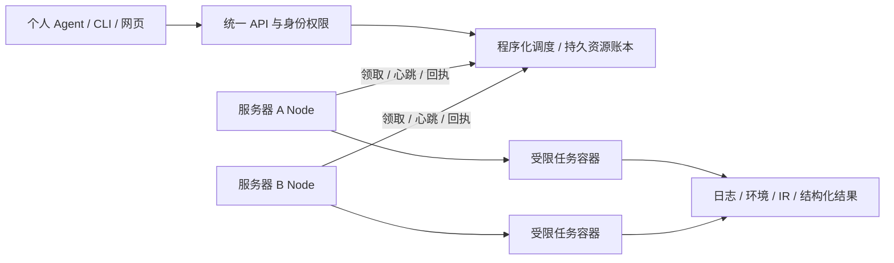

# AI-center-cann

新增[权威冷存读取与原件回收](https://github.com/1801ZDL/AI-center-cann/blob/main/COLD_RETENTION.md)：沿原任务ACL的日志/下载/报告/交接读取、确认原件删除后一次额度提交及恢复后显式读核验已贯通。最新1410项回归、两恢复路径各17个真实SIGKILL和卸载盘字节审计通过；历史数量计数和完整异地存储迁移仍待，未对Main执行数据迁移。

新增[旧pending库存管理员对账](https://github.com/1801ZDL/AI-center-cann/blob/main/STORAGE_RECONCILIATION.md)：停止态精确计划、同计划中断恢复、原计费/批准清单保留及缺helper的显式修复升级。输入和取消任务归档已做实际原生服务验收；它不执行冷存或自动清理，部署边界见PROGRESS.md。

面向 Triton-Ascend / AscendNPU-IR 开发服务器的 AI 任务调度与实验管理原型。程序化中央服务负责资源分配和可靠执行，个人 Agent、CLI 与网页通过同一 API 提交任务、读取日志和分析结果。

新增[控制记录的Root私有副本](https://github.com/1801ZDL/AI-center-cann/blob/main/CONTROL_HISTORY.md)：在迁出历史前，先冻结并校验原任务/幂等/尝试/结果/账单及相关引用，分块续写、封存后只读验证。当前不迁出SQL、不切换读取或释放名额；真实中断、服务只读视图和任务UID访问边界的范围见PROGRESS.md。

新增可显式启用的[在线归档/控制历史双容量](https://github.com/1801ZDL/AI-center-cann/blob/main/HISTORY_CAPACITY.md)：确认原件回收才释放在线名额，原任务和结果继续受有限历史上限约束；提供授权历史分页，以及启用后新普通任务在workspace恢复迁移后的原请求重连。现有个人Main保持原1100上限和计算预算，未执行迁移或删除；验收范围见PROGRESS.md。

**当前为 v0.36 基线加后续扩展，尚非生产就绪。** 已有个人身份/项目授权、持久资源账本、受控 Node、五类工作流、环境版本锁、日志归档、独立 CLI/MCP、分角色安装及备份恢复。同机隔离环境已验证真实 CPU 工作流、两任务 UID、硬配额和缓存；完整证据、失败记录与源码范围见 [PROGRESS.md](PROGRESS.md)。

新增[原生服务恢复与存储交接](UNIT_RELOCATION.md)：真实 systemd 控制器已接通独立 Node 和两任务 UID 的 CPU 工作流，中央重启保持原任务容器/attempt；目录恢复中断可沿 Root 原模板证据继续。修复隔离挂载视图导致的存储误判，仍保留实时 FD/嵌套挂载检查。最新1357项回归、双原生角色集成48项通过：补齐Node跨任务UID文件管理能力，实际验证旧unit刷新、任务中重启、缓存/配额和恢复；此前进程模式47项为独立历史范围。宿主开机、真实账号、NPU计算和两物理机仍需验收。

新机服务部署前可运行 `./servicectl systemd-doctor`，或给安装预检增加 `doctor --require-systemd`：只读核对原生 PID1/系统总线，避免把 `systemctl` 兼容脚本当作真实服务管理器。检查前置条件与实际服务启动分别报告，见 [部署说明](DEPLOYMENT.md)。

新增[真实容器 PID1 验收](https://github.com/1801ZDL/AI-center-cann/blob/main/NATIVE_SYSTEMD.md)：原始 controller unit 以非 root、零能力启动；启动调用方 SIGKILL 后沿原计划恢复，重复 apply 合计一次 StartUnit；控制器被杀后由 systemd 恢复新身份。目标宿主开机/挂载、真实登录用户、Node unit、NPU 与双物理机仍需各自验收。

新建固定环境/设备访问探针使用服务端小归档预算：2MiB产物加8MiB元数据，旧任务重放保留原额度。新探针会等待具备对应能力的Node升级，普通任务和设备资格不放宽，见[存储合同](STORAGE.md)。

新增[整体任务图提交](JOB_GRAPHS.md)：一次校验并持久接收多阶段托管任务，任一阶段准入失败整批回滚；提交中断后保留原任务编号、预算和产物交接。已有个人CLI及绑定指定流程的MCP，当前实测为CPU IR链和同机Root恢复，NPU阶段仍执行原准入门槛。

新增可选的[中央每日设备微自检计划](DEVICE_SCHEDULE.md)：管理员明确批准机器人、项目、精确卡、时区窗口和累计预算，中央通过普通队列在空闲时提交固定访问探针及微用例，前台优先、有限复探、未知执行跟踪原任务。备份恢复不能复活旧授权或已用额度；网页按原权限只读展示。默认没有计划，当前共享服务器未启用每日全卡测试。

[任务测量窗口](NPU_MEASUREMENT.md)最初以1147项回归、同机隔离Root安装39项和网页10项验收：Node记录任务请求的窗口时间、前后边界观测和区间内离散采样，原性能数据保留；真实CPU任务验证UID隔离、窗口中断及同容器恢复。此前[项目自检证据规则](DEVICE_EVIDENCE.md)仍可关联有限参考与有效期。设备窗口捕获为合成，当前共享主机不启用真实日程或规则。最新回归、验收范围和中间失败见 [PROGRESS.md](PROGRESS.md)。

设备管理采样、固定微用例与业务结果资格分别记录。新增[AI-core额定/当前频率快照](NPU_FREQUENCY.md)，已有两张卡的实际只读管理采样；主动自检及执行协议中的设备捕获仍为合成，真实 NPU 数值/性能、获批性能基线和业务证据规则的真机正向仍待验收；有限微用例一致不能声明完整设备健康。被动证据见 [NPU_CONDITIONS.md](NPU_CONDITIONS.md)，固定用例见 [NPU_SELFCHECK.md](NPU_SELFCHECK.md)。

增加服务器继续使用相同任务 API、客户端及结果格式，由管理员准备身份、设备、存储和服务后登记 Node。当前旧容器属于协作接入，不能拦截用户自行运行；真实宿主多用户、systemd PID1、两物理机故障/fencing 与百人规模负载仍待目标环境验收，见 [SCALING.md](SCALING.md) 与 [DEPLOYMENT.md](DEPLOYMENT.md)。

当前包已有[20账号CPU突发](TEAM_LOAD.md)的新实测：20个并发提交客户端及20个数值任务UID，在两个槽内完成60个IR/CMake冷暖任务，重放不重复执行，独立原盘/控制器审计通过。这是一次有限CPU场景，不能代替20个同时运行任务、真实宿主登录用户或NPU/两机/长期负载验收。



## 能力

- CPU、内存、SHM、NPU、槽位及存储准入；资源不足排队，同一物理域统一记账。
- 用户/项目授权、个人凭据、幂等提交、执行尝试跟踪和未知状态保留。
- 精度、性能、仿真、包编译、IR 五类工作流合同，输入封存和实际工具链摘要锁。
- 非 root 容器执行、独立 UID、工作盘字节/inode 配额、有限暂存、中央归档配额和私有缓存。
- 阶段依赖、封存产物交接、日志与结果表/CSV、个人目录归档。
- 独立 CLI/MCP 客户端、HTTPS、分角色安装、停机备份恢复及兼容回滚。

合同和接口存在不表示所有设备工作流已在真机通过。当前协作式旧容器入口不能拦截用户自行运行的命令；强制设备管理需要管理员配置设备权限、受控节点及旧容器迁移。

新增：提交前可用 `labctl submit --preview` 或 MCP `preview_job` 读取当前节点与准入阻碍；不入队或占用资源，预览不保证实际启动，见 [CLIENT.md](CLIENT.md) / [API.md](API.md)。普通任务仍可等待以后接入的服务器或环境。网页“托管作业”也可点击“检查可运行节点”，查看当前表单的节点与阻碍；修改表单后需重新检查。

网页现可在“提交方式 → 版本化工作流”导入已有五类任务请求，核对输入/环境锁/资源，再预览和显式提交；保持JSON中的幂等键，重试复用原任务。输入封存和个人目录自动归档继续使用CLI/MCP，见[WORKFLOWS.md](WORKFLOWS.md)。设备类任务能提交不代表NPU验收通过。

累计实验预算现可由个人账号批准任务次数及CPU/NPU申报秒数，再交付只绑定该预算的Agent profile；多个固定MCP会话共享计费，重试不重复扣费。恢复旧快照会冻结预算并撤销原委托，避免额度复活；只读历史访问可另行批准。说明见[EXPERIMENT_BUDGET.md](EXPERIMENT_BUDGET.md)。

## 本机 CPU Demo

要求 Linux、Python 3.10+。服务和客户端使用 Python 标准库；Node 的受控执行另需管理员准备 Docker、固定本地镜像和存储合同。不要以 root 启动个人 Demo。

```bash
git clone https://github.com/1801ZDL/AI-center-cann.git
cd AI-center-cann
./labctl start
./labctl access
```

浏览器打开 `http://127.0.0.1:18765`，使用 `labctl access` 显示的 Demo 凭据，**不是 SSH 密码**。默认只监听 loopback。远程访问可使用 SSH 转发：

```bash
ssh -N -L 18765:127.0.0.1:18765 YOUR_USER@YOUR_SERVER
```

在仓库目录提交一个 CPU 示例：

```bash
./labctl submit --name 'CPU 示例' --cpu 1 --memory-mib 256 \
  --shm-mib 0 --timeout 60 -- python -u examples/cpu_task.py --seconds 6
./labctl jobs
./labctl job job-替换为实际编号
./labctl logs job-替换为实际编号
```

默认试用预算为 2 个逻辑 CPU、2048 MiB 总内存、1024 MiB SHM、最多 1 个任务；实际 CPU 来自进程允许的集合。SHM 包含在总内存内。个人进程入口的内存/SHM 为协作式申报；受控 Node 容器另有实际 cgroup 限制。配置和数据库自动生成于私有 `runtime/`，不进入 Git。

`./labctl stop` 仅停止管理服务，运行任务继续；取消请使用 `./labctl cancel job-ID` 并等待确认。连接中断、观测超时或 `needs_attention` 不表示任务已结束，也不应据此重提。

## 管理员与多服务器接入

新增[协作入口启动前回队](COOPERATIVE_START.md)：分配后观测到卡被占用或健康改变，只有可信未启动回执及原执行器退出确认齐全才让原job退避等待；已经开始或未知的任务不自动重跑。最终1242项回归、同机Root安装42和网页12通过，实际HTTP/宿主/Docker CPU标记及两次SIGKILL恢复通过，设备观测为模拟。真实NPU初始化/计算仍未验收，当前新增真实请求等待后按queued-only取消，0attempt。

固定驱动诊断新增[自身子进程syscall观测](NPU_DRIVER_MAPPING.md)，该阶段1220项回归、20项专项及无设备观测通过，保持非root/零capability/默认seccomp。其真实设备请求在启动前占用复查被拒，未运行固定诊断，尚无真实设备syscall或新NPU计算结论。原87的open/ioctl触发点仍待空闲条件下取证；后续协作式启动竞争回队协议现见[COOPERATIVE_START.md](COOPERATIVE_START.md)。

新增[固定DSMI驱动编号对照](NPU_DRIVER_MAPPING.md)，最终1210项回归通过。真实单卡查询中宿主映射1→1→1成功，受限非root容器在设备数查询返回87，未进入映射/ACL；这将排查范围推进到驱动访问上下文，但不是设备计算通过或已确定根因。没有放宽普通资格或改变中央/Node部署；旧Root42/网页12仅沿用源码一致的证据，本轮未重新运行。

新增独立[非root CANN诊断](NPU_RUNTIME_DIAGNOSTIC.md)，最终1200项回归通过。真实受限容器中aclInit仍返回500000，已保留初始化/SoC查询阶段的有界错误证据，没有真实算子通过结论。中央/网页代码未改，原Root42/网页12的源码匹配证据沿用，本轮未重新部署。

中断窗口现保留独立有效的告警快照，原结果不改、不重建计时区间，见[NPU_MEASUREMENT.md](NPU_MEASUREMENT.md)。最终1189项回归、同机Root42项及网页12项通过。另一次真实重启后非root设备访问探针仍为EBUSY/blocked，普通精度任务0attempt；并无真机计算通过结论，详见[PROGRESS.md](PROGRESS.md)。

固定逐卡微用例现可绑定管理员明确批准的[经验性能参考](PERFORMANCE_REFERENCE.md)，与原业务均值/精度断言分列。原固定参考1171项回归、Root41项通过；新增[离线确认轮转](REFERENCE_MAINTENANCE.md)最终1183项回归、同机隔离Root42项和重新打包网页10项通过，含两次实际SIGKILL恢复。设备参考为合成验收，当前未创建真实NPU参考或启用规则。真实Linux用户/PID1、两物理机与峰值/长期负载仍需目标机验收；推广阶段与权限切换见[SCALING.md](SCALING.md)。

新管理员安装默认启用控制盘64MiB/256 inode余量准入，低余量暂停新增工作，原任务继续恢复；网页/MCP可读状态。旧Demo不自动启用，原生硬配额、留存和外部告警仍需另配，见[STORAGE.md](STORAGE.md)。

从当前权限到真实多用户和第二台物理机的边界、存储规划及逐步验收见[SCALING.md](SCALING.md)。

先阅读 [DEPLOYMENT.md](DEPLOYMENT.md) 的当前推广计划，再按 [SERVER.md](SERVER.md) 准备固定发布包、专用中央账号、节点凭据、设备及存储合同。

```bash
./servicectl bundle --output /PRIVATE_DELIVERY/ascend-lab-server.tar.gz
./servicectl doctor --role controller \
  --archive /PRIVATE_DELIVERY/ascend-lab-server.tar.gz \
  --prefix /opt/ascend-lab-controller --state-dir /var/lib/ascend-lab-controller \
  --create-service-user ascendlab --port 18765
```

`doctor` 只做预检。安装准备通过不代表生产验收通过；新中央默认要求的工作区、暂存盘等条件需由管理员明确准备。安装器不自动格式化系统盘、不重装驱动、不接管已有容器。

个人 Agent 可以位于各自主机账号或开发容器。公共二进制/公共能力包可以只读共享，个人 HOME/XDG、模型配置和会话必须按真实用户隔离。中央及个人 Agent 不持有 Docker socket；受信任 Node 负责创建任务容器。

已接入可选的离线算子性能报告：中央 CPU 任务调用固定上游工具，个人 harness 只读取有权限的归档报告；输入、安装和限制见 [OPERATOR_ANALYSIS.md](OPERATOR_ANALYSIS.md)。固定配方复用build_v1的CPU产物合同；当前不代表完整msagent或新的NPU优化验收。

历史性能报告读取器现从来源设备、频率、ELF及输入元数据重算比较结论，拒绝字节摘要正确但解释自相矛盾的报告；原归档和任务状态保留。1265项回归、当前新镜像的同机隔离Root35和报告网页11通过，完整且一致的旧v1继续读取。这里校验报告内部一致性，不认证历史采集或优化收益，详见[最新进度](PROGRESS.md)。

## Agent 接入

通用客户端不绑定模型供应商。通过 [CLIENT.md](CLIENT.md) 安装独立客户端，按 [HARNESS.md](HARNESS.md) 配置个人 stdio MCP；不同 harness 使用同一任务 API。追加编译、复现、上板和仿真仍需排队。

新增可选的[预算内小IR候选MCP](COMPILER_EXPERIMENT.md)：读取绑定失败、提出单处文字替换、封存并提交固定CPU实验、跟踪原job及读取归档。模型不能覆盖命令、工具锁和资源；恢复撤销旧消费授权。它是有限编译实验接口，实际验收范围见PROGRESS.md，不代表一般算子自动修复或NPU优化通过。

`agentctl` / `agent_runner.py` 保留早期本机 OpenCode 接入示例，依赖操作者单独授权的本地二进制和模型配置，仓库不包含这些内容，也不会替新用户配置模型。领域能力包的源码兼容核对不等于真实 bug 诊断或性能优化已经验收。

## 验证与文档

```bash
bash scripts/check.sh
# 与管理员服务安装器使用同一系统 Python：
bash scripts/check.sh /usr/bin/python3
```

需要 Python 3.10+ 和 Node.js。该命令运行单元检查及网页 JavaScript 语法检查，不运行 NPU、安装系统服务或调用模型。自有 Root/设备/live 验收需先准备隔离环境，不能直接在共享服务器上批量运行。

| 内容 | 文档 |
|---|---|
| 最新状态与缺口 | [PROGRESS.md](PROGRESS.md)、[BACKLOG.md](BACKLOG.md) |
| 服务安装与推广 | [SERVER.md](SERVER.md)、[DEPLOYMENT.md](DEPLOYMENT.md)、[HTTPS.md](HTTPS.md) |
| 客户端与 Agent | [CLIENT.md](CLIENT.md)、[HARNESS.md](HARNESS.md)、[API.md](API.md) |
| 环境与工作流 | [ENVIRONMENTS.md](ENVIRONMENTS.md)、[WORKFLOWS.md](WORKFLOWS.md)、[DEPENDENCIES.md](DEPENDENCIES.md) |
| 存储与恢复 | [WORKSPACE.md](WORKSPACE.md)、[STORAGE.md](STORAGE.md)、[SPOOL.md](SPOOL.md)、[CACHE.md](CACHE.md)、[RECOVERY.md](RECOVERY.md) |
| NPU 资格与现有限制 | [NPU.md](NPU.md) |

[公开验收摘要](reports/v036-public.json) 整理了历史检查范围；原始本机报告和测试盘不公开，见 [evidence/README.md](evidence/README.md)。本仓库不包含个人模型密钥、运行数据库、聊天记录、第三方工具二进制、CANN/LLVM 镜像或已有实验产物。

编译诊断的完整小IR、封存驱动及受保护工具锁绑定，见 [COMPILER_DIAGNOSTICS.md](COMPILER_DIAGNOSTICS.md)。当前只验最小实际解析/验证案例，不代表一般bug自动修复、完整lowering或数值验收。
