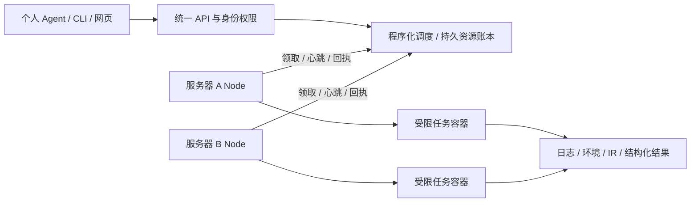

# AI-center-cann

面向 Triton-Ascend / AscendNPU-IR 开发服务器的 AI 任务调度与实验管理原型。程序化中央服务负责资源分配和可靠执行，个人 Agent 通过 MCP/API 提交任务、读取日志和分析结果。

**当前为 v0.36 基线加后续修复，尚非生产就绪。** 当前 450 项检查通过；新增旧命令产物限额的保存、幂等和收集校验，独立CLI实际提交/归档及升级重试已通过。此前同机 20 个逻辑用户的配额盘完整 Triton 冷暖构建、57 项 IR/CMake 混合任务、GiB 个人归档及独立原盘核验保留其受测发布范围。历史 Root54不重标；真实宿主多用户、非 root NPU 数值/性能/仿真及两台物理服务器仍待验收。最新进度以 [PROGRESS.md](PROGRESS.md) 为准。



## 能力

- CPU、内存、SHM、NPU、槽位及存储准入；资源不足排队，同一物理域统一记账。
- 用户/项目授权、个人凭据、幂等提交、执行尝试跟踪和未知状态保留。
- 精度、性能、仿真、包编译、IR 五类工作流合同，输入封存和实际工具链摘要锁。
- 非 root 容器执行、独立 UID、工作盘字节/inode 配额、有限暂存、中央归档配额和私有缓存。
- 阶段依赖、封存产物交接、日志与结果表/CSV、个人目录归档。
- 独立 CLI/MCP 客户端、HTTPS、分角色安装、停机备份恢复及兼容回滚。

合同和接口存在不表示所有设备工作流已在真机通过。当前协作式旧容器入口不能拦截用户自行运行的命令；强制设备管理需要管理员配置设备权限、受控节点及旧容器迁移。

## 本机 CPU Demo

要求 Linux、Python 3.10+。服务和客户端使用 Python 标准库；Node 的受控执行另需管理员准备 Docker、固定本地镜像和存储合同。不要以 root 启动个人 Demo。

```bash
git clone https://github.com/1801ZDL/AI-center-cann.git
cd AI-center-cann
./labctl start
./labctl access
```

浏览器打开 `http://127.0.0.1:18765`，使用 `labctl access` 显示的 Demo 凭据，**不是 SSH 密码**。默认只监听 loopback。远程访问可使用 SSH 转发：

```bash
ssh -N -L 18765:127.0.0.1:18765 YOUR_USER@YOUR_SERVER
```

在仓库目录提交一个 CPU 示例：

```bash
./labctl submit --name 'CPU 示例' --cpu 1 --memory-mib 256 \
  --shm-mib 0 --timeout 60 -- python -u examples/cpu_task.py --seconds 6
./labctl jobs
./labctl job job-替换为实际编号
./labctl logs job-替换为实际编号
```

默认试用预算为 2 个逻辑 CPU、2048 MiB 总内存、1024 MiB SHM、最多 1 个任务；实际 CPU 来自进程允许的集合。SHM 包含在总内存内。个人进程入口的内存/SHM 为协作式申报；受控 Node 容器另有实际 cgroup 限制。配置和数据库自动生成于私有 `runtime/`，不进入 Git。

`./labctl stop` 仅停止管理服务，运行任务继续；取消请使用 `./labctl cancel job-ID` 并等待确认。连接中断、观测超时或 `needs_attention` 不表示任务已结束，也不应据此重提。

## 管理员与多服务器接入

先阅读 [DEPLOYMENT.md](DEPLOYMENT.md) 的当前推广计划，再按 [SERVER.md](SERVER.md) 准备固定发布包、专用中央账号、节点凭据、设备及存储合同。

```bash
./servicectl bundle --output /PRIVATE_DELIVERY/ascend-lab-server.tar.gz
./servicectl doctor --role controller \
  --archive /PRIVATE_DELIVERY/ascend-lab-server.tar.gz \
  --prefix /opt/ascend-lab-controller --state-dir /var/lib/ascend-lab-controller \
  --create-service-user ascendlab --port 18765
```

`doctor` 只做预检。安装准备通过不代表生产验收通过；新中央默认要求的工作区、暂存盘等条件需由管理员明确准备。安装器不自动格式化系统盘、不重装驱动、不接管已有容器。

个人 Agent 可以位于各自主机账号或开发容器。公共二进制/公共能力包可以只读共享，个人 HOME/XDG、模型配置和会话必须按真实用户隔离。中央及个人 Agent 不持有 Docker socket；受信任 Node 负责创建任务容器。

## Agent 接入

通用客户端不绑定模型供应商。通过 [CLIENT.md](CLIENT.md) 安装独立客户端，按 [HARNESS.md](HARNESS.md) 配置个人 stdio MCP；不同 harness 使用同一任务 API。追加编译、复现、上板和仿真仍需排队。

`agentctl` / `agent_runner.py` 保留早期本机 OpenCode 接入示例，依赖操作者单独授权的本地二进制和模型配置，仓库不包含这些内容，也不会替新用户配置模型。领域能力包的源码兼容核对不等于真实 bug 诊断或性能优化已经验收。

## 验证与文档

```bash
bash scripts/check.sh
# 与管理员服务安装器使用同一系统 Python：
bash scripts/check.sh /usr/bin/python3
```

需要 Python 3.10+ 和 Node.js。该命令运行单元检查及网页 JavaScript 语法检查，不运行 NPU、安装系统服务或调用模型。自有 Root/设备/live 验收需先准备隔离环境，不能直接在共享服务器上批量运行。

| 内容 | 文档 |
|---|---|
| 最新状态与缺口 | [PROGRESS.md](PROGRESS.md)、[BACKLOG.md](BACKLOG.md) |
| 服务安装与推广 | [SERVER.md](SERVER.md)、[DEPLOYMENT.md](DEPLOYMENT.md)、[HTTPS.md](HTTPS.md) |
| 客户端与 Agent | [CLIENT.md](CLIENT.md)、[HARNESS.md](HARNESS.md)、[API.md](API.md) |
| 环境与工作流 | [ENVIRONMENTS.md](ENVIRONMENTS.md)、[WORKFLOWS.md](WORKFLOWS.md)、[DEPENDENCIES.md](DEPENDENCIES.md) |
| 存储与恢复 | [WORKSPACE.md](WORKSPACE.md)、[STORAGE.md](STORAGE.md)、[SPOOL.md](SPOOL.md)、[CACHE.md](CACHE.md)、[RECOVERY.md](RECOVERY.md) |
| NPU 资格与现有限制 | [NPU.md](NPU.md) |

[公开验收摘要](reports/v036-public.json) 整理了历史检查范围；原始本机报告和测试盘不公开，见 [evidence/README.md](evidence/README.md)。本仓库不包含个人模型密钥、运行数据库、聊天记录、第三方工具二进制、CANN/LLVM 镜像或已有实验产物。
